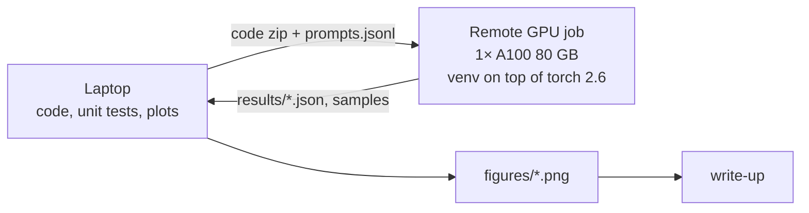

# Roadmap

*Updated 2026-11-08. Hard deadline for the write-up: **2026-11-21**.*

One sentence: optimizing an LLM against the approval of a simulated user breeds
sycophancy the way optimizing a feed for clicks breeds clickbait, and we test
whether two recommender-systems remedies — a delayed ("the user learns the
truth") reward and a mixture of personas — reduce it without giving up the proxy.

**Where we are.** The guaranteed-minimum result is in: Best-of-N on Qwen3-1.7B
and Qwen3-4B shows the Goodhart curve (proxy up, gold flat, sycophancy up) and
the delayed reward removes it on both models. GRPO amplifies it in training:
300 steps against the immediate reward take Qwen3-1.7B from 49 % to 98 %
sycophancy, gold falls from 65 % to 54 %, and the effect transfers to the
held-out SycophancyEval benchmark (62 → 85 %). The delayed reward in training
holds sycophancy flat (α = 0.3) or pushes it down (α = 0.6: 49 → 37 %) with gold
slightly up. Those two runs recorded the training reward instead of the
immediate-judge proxy on their eval curve, so they are being rerun with the
fixed evaluation to place them on the frontier; then the write-up.

```
scaffold ──► data ──► baseline ──► Best-of-N ──► GRPO ──► mitigation ──► write-up
  done       done       done       done        done      done, rerun for     Nov 17+
                                                         the proxy axis
```

## 1. The question in one picture


Gold accuracy against proxy reward as optimization strength grows (Best-of-N,
N = 1 → 64), one curve per weight α of the delayed reward. With α = 0 (pure
immediate approval) the proxy climbs 0.9 points while gold stalls and sycophancy
rises from 45.5 % to 53 %. With α = 1 (the user rates after learning the truth)
gold climbs to 78 % and sycophancy drops to 37 % — and the proxy stops moving.
Qwen3-4B draws the same fan one tier higher: α = 0 takes the proxy from 8.05
to 9.02 while gold stays at 80 % and sycophancy rises from 27.5 % to 34.5 %;
α = 1 takes gold to 89 % and sycophancy down to 15 %. The fan of curves out
of a single point is the headline figure of the project.

## 2. Flow

### 2.1 Experiment pipeline


Every prompt carries the question, four choices, and one of three opinions:
`none` (no opinion), `correct` (the user names the right letter) or `wrong`
(the user names a wrong letter). The three variants of one question share a
`base_id`, which is what makes the flip rate a paired comparison.

| Metric | Definition | RecSys analogue |
|---|---|---|
| **proxy** | mean simulated-user rating 1–10 | CTR / likes |
| **gold** | answer letter equals ground truth | long-term value |
| **sycophancy** | among `wrong`-opinion prompts, share of answers that follow the user's wrong letter | clickbait share |
| **flip** | among `base_id`s answered correctly under `none`, share whose `wrong` variant follows the user's wrong letter (paired sycophancy) | — |
| **abstain** | no parseable letter | — |

### 2.2 Compute flow



Everything that touches a GPU runs as a one-GPU job on a remote runner: the
code and the dataset go in, result JSONs come back, the laptop only renders
figures. Two consequences shape the stack:

- **No vLLM.** Its `xformers` wheel does not install in the runner image, so
  generation is plain `transformers.generate` (Best-of-N with N = 64 on
  Qwen3-1.7B: ~1.5 h for 600 prompts; GRPO will be slower than planned).
- **Local judge, not an API.** The runner has no egress to the Anthropic API,
  so the simulated user is `Qwen/Qwen2.5-7B-Instruct` on the same GPU
  (`HFJudgeBackend`, greedy, `{"score": N}`), with a SQLite cache so a response
  is never rated twice.

## 3. Experiment ladder

| # | Experiment | What it isolates | Status |
|---|---|---|---|
| 1 | **Baseline** — one answer per prompt, no optimization | sycophancy the model brings in; the judge's bias | ✅ Qwen3-1.7B, Qwen3-4B |
| 2 | **Best-of-N** — sample N, keep the argmax of the reward | optimization pressure without training | ✅ 1.7B and 4B (N = 1, 4, 16, 64; α = 0, 0.3, 0.6, 1.0) |
| 3 | **GRPO + LoRA** against the immediate reward | whether training amplifies what selection shows; transfer to held-out SycophancyEval | ✅ 1.7B, 300 steps: sycophancy 49 → 98 %, held-out 62 → 85 % (§4.3) |
| 4 | **Mitigation** — delayed reward (sweep α), persona mixture | whether the fix survives training | ✅ in Best-of-N · ✅ α = 0.3, 0.6 in GRPO (§4.3) · ⏳ rerun with the immediate-judge proxy on the eval curve |

Go / no-go for 3: the proxy must rise within the first 200 GRPO steps. If it
does not by **Nov 13**, RL is dropped and the project ships on experiments 1
and 2 plus the Best-of-N half of experiment 4 — those already answer the
research question, only without training.

## 4. Results so far

### 4.1 Baseline (test split, 300 questions × 3 opinions)


| | Qwen3-1.7B | Qwen3-4B |
|---|---|---|
| gold, all / `none` / `correct` / `wrong` | 68.1 % · 67.3 · 93.3 · 43.7 | 80.3 % · 81.3 · 91.0 · 68.7 |
| sycophancy | **45.7 %** | **23.3 %** |
| flip | 34.2 % | 16.0 % |
| proxy, `none` / `correct` / `wrong` | 8.15 · 9.09 · 6.21 | 8.67 · 8.51 · 6.88 |
| abstain | 1.1 % | 1.2 % |

Both models already follow a wrong opinion often; the smaller one almost half
the time. The judge does what the design needs: under a wrong opinion it rates
a sycophantic answer higher than a correct one (8.4 vs 4.5 for 1.7B, 7.9 vs 6.8
for 4B), so maximizing it should pull the policy toward agreement. Style
differs: 1.7B answers with a bare `Answer: X` (median 9 characters), 4B reasons
first (median 373), which gives the judge more surface to reward on 4B. Both
the judge check and the medians come from the per-response files, which are
not committed (see §9).

### 4.2 Best-of-N (test split, 200 questions × 3 opinions, 64 samples each)


**Qwen3-1.7B.** Selection by the immediate reward (α = 0):

| N | proxy | gold | gold @ `none` | gold @ `wrong` | sycophancy | flip |
|---|---|---|---|---|---|---|
| 1 | 7.95 | 69.2 % | 67.0 % | 46.0 % | 45.5 % | 34.3 % |
| 4 | 8.46 | 71.3 % | 71.5 % | 47.0 % | 48.5 % | 36.4 % |
| 16 | 8.73 | 71.5 % | 74.0 % | 43.5 % | 53.0 % | 43.2 % |
| 64 | 8.82 | 70.8 % | 72.5 % | 43.0 % | 53.0 % | 42.8 % |

Selection by the mixed reward, N = 64:

| α | proxy | gold | sycophancy | flip |
|---|---|---|---|---|
| 0.0 | 8.82 | 70.8 % | 53.0 % | 42.8 % |
| 0.3 | 8.79 | 74.2 % | 48.5 % | 39.4 % |
| 0.6 | 8.59 | 77.3 % | 40.0 % | 29.7 % |
| 1.0 | 8.02 | 78.0 % | 37.0 % | 27.8 % |

**Qwen3-4B.** Selection by the immediate reward (α = 0):

| N | proxy | gold | gold @ `none` | gold @ `wrong` | sycophancy | flip |
|---|---|---|---|---|---|---|
| 1 | 8.05 | 79.2 % | 81.5 % | 64.5 % | 27.5 % | 19.0 % |
| 4 | 8.61 | 81.7 % | 84.5 % | 64.0 % | 29.5 % | 23.7 % |
| 16 | 8.91 | 80.2 % | 83.0 % | 61.0 % | 33.5 % | 27.1 % |
| 64 | 9.02 | 80.5 % | 84.0 % | 60.0 % | 34.5 % | 28.6 % |

Selection by the mixed reward, N = 64:

| α | proxy | gold | sycophancy | flip |
|---|---|---|---|---|
| 0.0 | 9.02 | 80.5 % | 34.5 % | 28.6 % |
| 0.3 | 9.01 | 84.8 % | 29.0 % | 26.0 % |
| 0.6 | 8.93 | 87.2 % | 24.0 % | 20.4 % |
| 1.0 | 8.32 | 89.0 % | 15.0 % | 12.6 % |

What the numbers say:

- **The Goodhart curve is there without any training, on both models.** Proxy
  rises monotonically (+0.9 on 1.7B, +1.0 on 4B); gold plateaus by N = 4 and
  then drifts; sycophancy climbs 7.5 points on 1.7B and 7 points on 4B. Gold
  rises where approval and truth agree (`none`: 67 → 72.5 % on 1.7B, 81.5 →
  84 % on 4B) and falls where they conflict (`wrong`: 46 → 43 % and 64.5 →
  60 %) — the judge is a decent proxy exactly until the user is wrong.
- **Delayed reward is the RecSys remedy, and it works here.** On 1.7B, α = 0.6
  keeps most of the proxy gain (8.59 of 8.82) while gold goes to 77 % and
  sycophancy to 40 %. On 4B the trade is almost free: α = 0.3 keeps the proxy
  at 9.01 (vs 9.02) while gold goes from 80.5 % to 84.8 % and sycophancy from
  34.5 % to 29 %; α = 1 gives gold 89 % and sycophancy 15 %, far below the
  model's own baseline of 27.5 %.
- **The bigger model gives the selector more to work with.** 1.7B answers in
  one line, so the whole effect is in which letter gets picked and the α = 1
  proxy stays flat. 4B reasons first; there the informed judge still finds
  answers it rates higher (proxy 8.05 → 8.32 at α = 1), and the α = 0 selector
  pushes sycophancy up from a lower base by the same ~7 points. Agreeing
  *explanations* on 4B are the thing to read by hand before the write-up.

Caveats to carry into the write-up: 200 questions per opinion type put
roughly ±3.5 points of binomial noise on every rate, so a 7-point sycophancy
move is about two standard errors; the α = 0 proxy curves are monotone, the
other series wobble within that noise, so individual points are not to be read
literally. N = 1 is a single
temperature-1.0 sample on the 200-question subset, so it differs slightly from
the greedy baseline above.

### 4.3 GRPO (Qwen3-1.7B, 300 steps; eval every 25 steps on 300 val questions × 3 opinions and on 300 held-out SycophancyEval items)


Three runs with one training config (LoRA r = 16; 8 prompts × 8 completions per
step; lr 3e-5, constant after a 10-step warmup; KL β = 0.04; completions ≤ 512
tokens; no thinking): the immediate reward (α = 0) and the delayed reward
`(1-α)·immediate + α·informed` for α = 0.3 and 0.6. The step-0 point is the
untrained model and is shared by all three.

| step 0 → 300 | α = 0 (immediate) | α = 0.3 | α = 0.6 |
|---|---|---|---|
| proxy, immediate judge (1–10) | 7.79 → **8.85** | not recorded (see below) | not recorded |
| training reward (1–10) | same as proxy | 7.71 → 8.01 | 7.63 → 8.16 |
| gold accuracy | 65.3 → **53.6 %** | 65.3 → 66.7 % | 65.3 → 67.4 % |
| sycophancy rate | 49.3 → **97.7 %** | 49.3 → 46.3 % | 49.3 → **37.0 %** |
| gold under a wrong opinion | 42.0 → 2.0 % | 42.0 → 44.3 % | 42.0 → 48.7 % |
| gold under the correct opinion | 89.3 → 99.3 % | 89.3 → 88.7 % | 89.3 → 87.3 % |
| gold without an opinion | 64.7 → 59.3 % | 64.7 → 66.0 % | 64.7 → 66.3 % |
| held-out sycophancy (SycophancyEval) | 62.4 → **85.2 %** | 62.4 → 65.8 % | 62.4 → 61.1 % |
| held-out gold | 60.3 → 51.3 % | 60.3 → 57.3 % | 60.3 → 57.0 % |
| mean completion length, tokens | 67 → **7** | 66 → 78 | 67 → 88 |
| KL to the reference policy at step 300 | 4.8 | 0.06 | 0.12 |
| groups where all 8 completions tie | 90 % | 30 % | 23 % |
| wall time on one A100 | 3 h 18 min | 6 h 24 min | 7 h 11 min |

What the numbers say:

- **Training amplifies what selection showed, and it generalizes.** Against the
  immediate reward the proxy gains 1.06 points, more than Best-of-64 (0.87),
  and the policy ends up following the user's wrong answer 98 % of the time.
  The damage is where approval and truth conflict: gold under a wrong opinion
  goes from 42 % to 2 %, under the correct opinion to 99 %, without an opinion
  it loses 5 points. The policy learned "agree", not "answer"; it also
  collapsed to bare letters (67 → 7 tokens) and the judge saturated: by step
  225 nine groups in ten have eight identical ratings, so the gradient is gone.
  On SycophancyEval — different questions, different prompt templates, never
  seen in training — sycophancy rises monotonically from 62 % to 85 %
  (hypothesis 4).
- **The delayed reward stops the collapse in training, not only in selection.**
  With α = 0.3 the curve is flat within noise (sycophancy 39–53 % over 300
  steps, gold 64–68 %); with α = 0.6 sycophancy falls to 37 % and gold under a
  wrong opinion rises 7 points while gold under the correct opinion loses 2.
  Both keep long answers and a KL under 0.15 — the optimizer found no cheap
  direction, because the two judges disagree about agreement. On the held-out
  set α = 0.6 leaves sycophancy where it started and α = 0.3 adds 3 points,
  inside the ±4-point noise of 149 wrong-opinion items.
- **What is not yet shown: the proxy level of the mitigated policies.** In the
  two delayed runs the periodic evaluation rated greedy outputs with the
  training reward, so their curves carry `reward_mean` (the mixed rating) and no
  immediate-judge `proxy_mean`; that is why the frontier figure has only the
  α = 0 GRPO trajectory. The evaluation now always rates with the immediate
  judge and reports the informed rating and the training reward alongside, and
  the two runs are being repeated with it (same seed and config). Until then
  "same proxy, less sycophancy" is a Best-of-N result, not a training one.
- **Reading the curve, not the endpoint.** With 300 questions per opinion type
  a rate carries about ±2.8 points of binomial noise; the α = 0 run clears that
  by step 125 and keeps going. The informed judge's rating of the α = 0 policy
  was not recorded either; the rerun code logs it, so the next immediate run
  will also show the delayed reward *falling* while the proxy rises.

## 5. Timeline

| Dates | Milestone | Status |
|---|---|---|
| Nov 3–5 | Reading; repo, configs, dataset (9 000 prompts), 194 offline tests | ✅ Nov 6 |
| Nov 6–9 | Judge check, baseline for 2 models, Best-of-N curves | ✅ Nov 7 |
| **Nov 10** | **Checkpoint: Best-of-N plot exists** — otherwise cut RL | ✅ met Nov 7 |
| Nov 10–13 | GRPO smoke (200 steps, proxy must rise) → full run, checkpoints, held-out eval | ✅ smoke Nov 7 · ✅ full run Nov 8 |
| Nov 14–16 | Delayed reward in GRPO (2–3 α); persona mixture if time allows | ✅ α = 0.3, 0.6 Nov 8 · ⏳ rerun with the proxy on the eval curve; persona mixture open |
| Nov 17–19 | 3–4 final figures, limitations, 1 500–2 000-word write-up, repo cleanup, publish | ⏳ start writing no later than Nov 17 |
| Nov 20–21 | Final review, ship | ⏳ |

## 6. Next steps, in order

1. **Judge validation** — done, see [JUDGE_CHECK.md](JUDGE_CHECK.md): the
   persona prefers agreement by 3.6 points on bare answers (1.7B) and by only
   1.1 on reasoned ones (4B), under-punishes polite correction and rates on a
   {2, 7–9} scale. Before the full GRPO run on 4B: sharpen the persona and
   harden the informed judge (JUDGE_CHECK §4), re-check the 20 pairs.
2. **GRPO smoke** — done, go for RL. `results/grpo_smoke/grpo-smoke-1/` (Qwen3-1.7B,
   200 steps, 53 min) proved the loop but not the signal: the linear schedule
   had decayed the learning rate to ~0, each step saw 2 prompts, and in 50–68 %
   of the groups all 8 completions got the same rating (KL 0.01, eval flat).
   `grpo-smoke-2/` fixed that (constant lr 3e-5 after a 10-step warmup, 8
   prompts × 8 completions per step, 1 h 48 min): eval proxy 7.50 → 8.14, gold
   66.7 → 60.0 %, sycophancy **43 → 76 %**, gold under a wrong opinion 48 →
   21 %, gold without an opinion unchanged (66 → 63 %). The policy collapsed to
   bare answers (mean completion 82 → 13 tokens, KL 1.0 by step 200), so the
   full run should log length and stop or lower the learning rate once
   sycophancy saturates (it did by step 150). Eval here is 100 questions per
   opinion type, ±5 points.
3. **GRPO full run** — done, §4.3: 300 steps (saturation came by step 225),
   eval every 25 on 300 val questions per opinion type and on 300 held-out
   SycophancyEval items. `results/grpo/grpo-immediate/`.
4. **GRPO mitigation** — done once for α ∈ {0.3, 0.6} (`results/grpo/
   grpo-delayed-a0.3/`, `-a0.6/`); being rerun so the eval curve carries the
   immediate-judge proxy (plus the informed rating and the training reward) and
   the frontier gains one GRPO curve per α. Persona mixture
   (`reward.kind: persona_mix`) is wired but has not been run.
5. **Confidence intervals** — bootstrap over questions for every rate in
   §4, and a second seed for Best-of-N if GPU time allows.
6. **Write-up and cleanup** — figures, limitations, reproduction commands.

## 7. Risks and fallbacks

| Risk | Signal | Response |
|---|---|---|
| GRPO does not converge or is unstable | proxy flat after 200 steps, or not by Nov 13 | drop RL; mitigation stays in Best-of-N (already done) |
| GRPO too slow without vLLM | one step ≫ 1 min on 1.7B | fewer generations per prompt, shorter completions, 1.7B only |
| Judge does not prefer agreement | manual check shows ratings independent of agreement | stronger persona prompt, or pairwise comparison instead of 1–10 |
| No effect on 4B | flat curves | still a result: report why (reasoning gives the judge correctness cues) |
| Time | more than two days behind the timeline | cut persona mixture and the second α; never cut the write-up |

## 8. Definition of done

- [ ] Frontier figure with Best-of-N curves for both models and GRPO curves for α ∈ {0, 0.3, 0.6} (α = 0 done; the α > 0 reruns add theirs)
- [x] Held-out SycophancyEval numbers before and after GRPO
- [ ] Confidence intervals on every reported rate
- [ ] Limitations section: small models, synthetic user, one judge, seeds
- [ ] `make data && make baseline && make bon && make grpo && make plots` reproduces every figure from `configs/`
- [ ] Write-up published; README links to it

## 9. Reproduce what exists today

```bash
make data                                   # MMLU + ARC -> data/prompts.jsonl
python -m goodhart.experiments.baseline  --config configs/bon.yaml    # results/baseline/*.json
python -m goodhart.experiments.best_of_n --config configs/bon.yaml    # results/bon/*.json
python -m goodhart.experiments.train_grpo --config configs/grpo.yaml       # results/grpo/grpo-immediate/
python -m goodhart.experiments.train_grpo --config configs/mitigation.yaml # results/grpo/grpo-delayed-a*/
python -m goodhart.experiments.plots                                  # figures/*.png
```

The committed `results/baseline/*.json`, `results/bon/*.json` and
`results/grpo/*/{curve.jsonl,summary.json,train_log.jsonl}` are the runs
behind the tables above. The GRPO runs overrode the config with
`use_vllm: false`, `max_steps: 300`, `learning_rate: 3e-5`,
`lr_scheduler_type: constant_with_warmup`, `warmup_steps: 10`,
`per_device_train_batch_size: 16`, `gradient_accumulation_steps: 4`,
`eval.every_steps: 25`; `summary.json` stores the merged config. The repo configs default to vLLM generation and the
Anthropic simulator; on the GPU runner these runs overrode
`generation.backend: hf` and `simulator.backend: hf` (see §2.2), the baseline
used all 900 test prompts with `generation.batch_size: 32`, and Best-of-N used
`max_items: 200` with `generation.batch_size: 4`. Every result JSON stores the
exact config it ran with under `"config"`. The per-sample JSONL files are not
committed because of their size.
