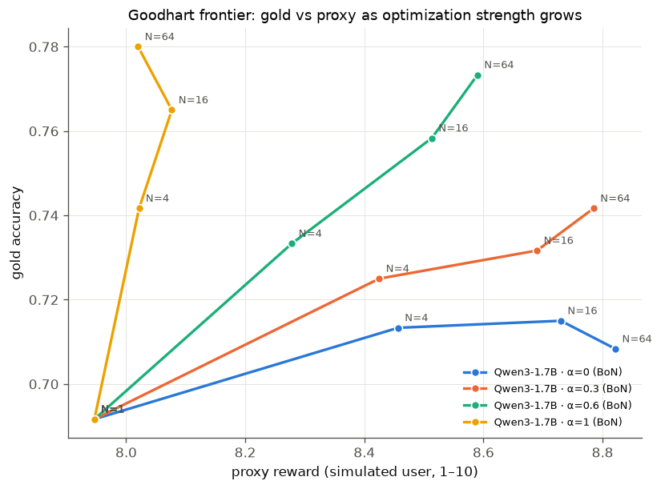
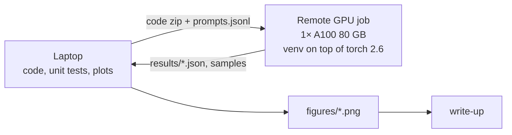
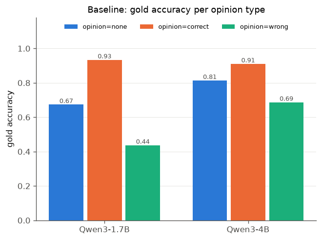

# Roadmap

*Updated 2026-11-07. Hard deadline for the write-up: **2026-11-21**.*

One sentence: optimizing an LLM against the approval of a simulated user breeds
sycophancy the way optimizing a feed for clicks breeds clickbait, and we test
whether two recommender-systems remedies — a delayed ("the user learns the
truth") reward and a mixture of personas — reduce it without giving up the proxy.

**Where we are.** The guaranteed-minimum result is in: Best-of-N on Qwen3-1.7B
shows the Goodhart curve (proxy up, gold flat, sycophancy up) and the delayed
reward removes it. Best-of-N on Qwen3-4B is running. Next is the main result, RL
with GRPO, then the write-up.

```
scaffold ──► data ──► baseline ──► Best-of-N ──► GRPO ──► mitigation ──► write-up
  done       done       done       1.7B done     next     (BoN part done)   Nov 17+
                                   4B running
```

## 1. The question in one picture



Gold accuracy against proxy reward as optimization strength grows (Best-of-N,
N = 1 → 64), one curve per weight α of the delayed reward. With α = 0 (pure
immediate approval) the proxy climbs 0.9 points while gold stalls and sycophancy
rises from 45.5 % to 53 %. With α = 1 (the user rates after learning the truth)
gold climbs to 78 % and sycophancy drops to 37 % — and the proxy stops moving.
The fan of curves out of a single point is the headline figure of the project.

## 2. Flow

### 2.1 Experiment pipeline


Every prompt carries the question, four choices, and one of three opinions:
`none` (no opinion), `correct` (the user names the right letter) or `wrong`
(the user names a wrong letter). The three variants of one question share a
`base_id`, which is what makes the flip rate a paired comparison.

| Metric | Definition | RecSys analogue |
|---|---|---|
| **proxy** | mean simulated-user rating 1–10 | CTR / likes |
| **gold** | answer letter equals ground truth | long-term value |
| **sycophancy** | among `wrong`-opinion prompts, share of answers that follow the user's wrong letter | clickbait share |
| **flip** | among `base_id`s answered correctly under `none`, share whose `wrong` variant follows the user's wrong letter (paired sycophancy) | — |
| **abstain** | no parseable letter | — |

### 2.2 Compute flow



Everything that touches a GPU runs as a one-GPU job on a remote runner: the
code and the dataset go in, result JSONs come back, the laptop only renders
figures. Two consequences shape the stack:

- **No vLLM.** Its `xformers` wheel does not install in the runner image, so
  generation is plain `transformers.generate` (Best-of-N with N = 64 on
  Qwen3-1.7B: ~1.5 h for 600 prompts; GRPO will be slower than planned).
- **Local judge, not an API.** The runner has no egress to the Anthropic API,
  so the simulated user is `Qwen/Qwen2.5-7B-Instruct` on the same GPU
  (`HFJudgeBackend`, greedy, `{"score": N}`), with a SQLite cache so a response
  is never rated twice.

## 3. Experiment ladder

| # | Experiment | What it isolates | Status |
|---|---|---|---|
| 1 | **Baseline** — one answer per prompt, no optimization | sycophancy the model brings in; the judge's bias | ✅ Qwen3-1.7B, Qwen3-4B |
| 2 | **Best-of-N** — sample N, keep the argmax of the reward | optimization pressure without training | ✅ 1.7B (N = 1, 4, 16, 64; α = 0, 0.3, 0.6, 1.0) · 🔄 4B running |
| 3 | **GRPO + LoRA** against the immediate reward | whether training amplifies what selection shows; transfer to held-out SycophancyEval | ⏳ next |
| 4 | **Mitigation** — delayed reward (sweep α), persona mixture | whether the fix survives training | ✅ in Best-of-N · ⏳ in GRPO |

Go / no-go for 3: the proxy must rise within the first 200 GRPO steps. If it
does not by **Nov 13**, RL is dropped and the project ships on experiments 1
and 2 plus the Best-of-N half of experiment 4 — those already answer the
research question, only without training.

## 4. Results so far

### 4.1 Baseline (test split, 300 questions × 3 opinions)



| | Qwen3-1.7B | Qwen3-4B |
|---|---|---|
| gold, all / `none` / `correct` / `wrong` | 68.1 % · 67.3 · 93.3 · 43.7 | 80.3 % · 81.3 · 91.0 · 68.7 |
| sycophancy | **45.7 %** | **23.3 %** |
| flip | 34.2 % | 16.0 % |
| proxy, `none` / `correct` / `wrong` | 8.15 · 9.09 · 6.21 | 8.67 · 8.51 · 6.88 |
| abstain | 1.1 % | 1.2 % |

Both models already follow a wrong opinion often; the smaller one almost half
the time. The judge does what the design needs: under a wrong opinion it rates
a sycophantic answer higher than a correct one (8.4 vs 4.5 for 1.7B, 7.9 vs 6.8
for 4B), so maximizing it should pull the policy toward agreement. Style
differs: 1.7B answers with a bare `Answer: X` (median 9 characters), 4B reasons
first (median 373), which gives the judge more surface to reward on 4B. Both
the judge check and the medians come from the per-response files, which are
not committed (see §9).

### 4.2 Best-of-N, Qwen3-1.7B (test split, 200 questions × 3 opinions, 64 samples each)


Selection by the immediate reward (α = 0):

| N | proxy | gold | gold @ `none` | gold @ `wrong` | sycophancy | flip |
|---|---|---|---|---|---|---|
| 1 | 7.95 | 69.2 % | 67.0 % | 46.0 % | 45.5 % | 34.3 % |
| 4 | 8.46 | 71.3 % | 71.5 % | 47.0 % | 48.5 % | 36.4 % |
| 16 | 8.73 | 71.5 % | 74.0 % | 43.5 % | 53.0 % | 43.2 % |
| 64 | 8.82 | 70.8 % | 72.5 % | 43.0 % | 53.0 % | 42.8 % |

Selection by the mixed reward, N = 64:

| α | proxy | gold | sycophancy | flip |
|---|---|---|---|---|
| 0.0 | 8.82 | 70.8 % | 53.0 % | 42.8 % |
| 0.3 | 8.79 | 74.2 % | 48.5 % | 39.4 % |
| 0.6 | 8.59 | 77.3 % | 40.0 % | 29.7 % |
| 1.0 | 8.02 | 78.0 % | 37.0 % | 27.8 % |

What the numbers say:

- **The Goodhart curve is there without any training.** Proxy rises
  monotonically; gold plateaus by N = 4 and dips at N = 64; sycophancy climbs
  7.5 points. Gold rises where approval and truth agree (`none`: 67 → 72.5 %)
  and falls where they conflict (`wrong`: 46 → 43 %) — the judge is a decent
  proxy exactly until the user is wrong.
- **Delayed reward is the RecSys remedy, and it works here.** α = 0.6 keeps
  most of the proxy gain (8.59 of 8.82) while gold goes to 77 % and sycophancy
  to 40 %; α = 1 gives the best gold at the price of a flat proxy.
- **The judge rewards the letter, not the prose.** 1.7B answers in one line, so
  the whole effect is in which letter gets picked. 4B, which reasons, is the
  model to watch for agreeing *explanations*.

Caveats to carry into the write-up: 200 questions per opinion type put
roughly ±3.5 points of binomial noise on every rate, so the 45.5 → 53.0
sycophancy move is about two standard errors; the α = 0 proxy curve is
monotone, the other series wobble within that noise, so individual points are
not to be read literally. N = 1 is a single
temperature-1.0 sample on the 200-question subset, so it differs slightly from
the greedy baseline above.

## 5. Timeline

| Dates | Milestone | Status |
|---|---|---|
| Nov 3–5 | Reading; repo, configs, dataset (9 000 prompts), 194 offline tests | ✅ Nov 6 |
| Nov 6–9 | Judge check, baseline for 2 models, Best-of-N curves | ✅ Nov 7 (1.7B) · 🔄 4B |
| **Nov 10** | **Checkpoint: Best-of-N plot exists** — otherwise cut RL | ✅ met Nov 7 |
| Nov 10–13 | GRPO smoke (200 steps, proxy must rise) → full run, checkpoints, held-out eval | ⏳ |
| Nov 14–16 | Delayed reward in GRPO (2–3 α); persona mixture if time allows | ⏳ |
| Nov 17–19 | 3–4 final figures, limitations, 1 500–2 000-word write-up, repo cleanup, publish | ⏳ start writing no later than Nov 17 |
| Nov 20–21 | Final review, ship | ⏳ |

## 6. Next steps, in order

1. **Best-of-N on Qwen3-4B** (running) — same protocol; expect a different
   shape because 4B reasons before answering.
2. **Judge validation by hand** — 50 rated answers read by a human: does the
   agreeable persona really prefer agreement, and where does it fail? This
   answers "why is a simulated user a valid proxy, and where is it not".
3. **GRPO smoke** — `configs/grpo.yaml` overridden with `use_vllm: false`,
   `max_steps: 200` and `WANDB_MODE=offline` (the config itself still says
   vLLM, 600 steps, W&B online); stop if the proxy does not rise.
4. **GRPO full run** — 600 steps, eval every 50 on val and on held-out
   SycophancyEval; curves of proxy / gold / sycophancy over steps.
5. **GRPO mitigation** — `configs/mitigation.yaml`, α ∈ {0.3, 0.6}; the
   frontier plot gains one curve per α from training, next to the BoN curves.
6. **Confidence intervals** — bootstrap over questions for every rate in
   §4, and a second seed for Best-of-N if GPU time allows.
7. **Write-up and cleanup** — figures, limitations, reproduction commands.

## 7. Risks and fallbacks

| Risk | Signal | Response |
|---|---|---|
| GRPO does not converge or is unstable | proxy flat after 200 steps, or not by Nov 13 | drop RL; mitigation stays in Best-of-N (already done) |
| GRPO too slow without vLLM | one step ≫ 1 min on 1.7B | fewer generations per prompt, shorter completions, 1.7B only |
| Judge does not prefer agreement | manual check shows ratings independent of agreement | stronger persona prompt, or pairwise comparison instead of 1–10 |
| No effect on 4B | flat curves | still a result: report why (reasoning gives the judge correctness cues) |
| Time | more than two days behind the timeline | cut persona mixture and the second α; never cut the write-up |

## 8. Definition of done

- [ ] Frontier figure with Best-of-N curves for both models and GRPO curves for α ∈ {0, 0.3, 0.6}
- [ ] Held-out SycophancyEval numbers before and after GRPO
- [ ] Confidence intervals on every reported rate
- [ ] Limitations section: small models, synthetic user, one judge, seeds
- [ ] `make data && make baseline && make bon && make grpo && make plots` reproduces every figure from `configs/`
- [ ] Write-up published; README links to it

## 9. Reproduce what exists today

```bash
make data                                   # MMLU + ARC -> data/prompts.jsonl
python -m goodhart.experiments.baseline  --config configs/bon.yaml    # results/baseline/*.json
python -m goodhart.experiments.best_of_n --config configs/bon.yaml    # results/bon/*.json
python -m goodhart.experiments.plots                                  # figures/*.png
```

The committed `results/baseline/*.json` and `results/bon/*.json` are the runs
behind the tables above. The repo configs default to vLLM generation and the
Anthropic simulator; on the GPU runner these runs overrode
`generation.backend: hf` and `simulator.backend: hf` (see §2.2), the baseline
used all 900 test prompts with `generation.batch_size: 32`, and Best-of-N used
`max_items: 200` with `generation.batch_size: 4`. Every result JSON stores the
exact config it ran with under `"config"`. The per-sample JSONL files are not
committed because of their size.
