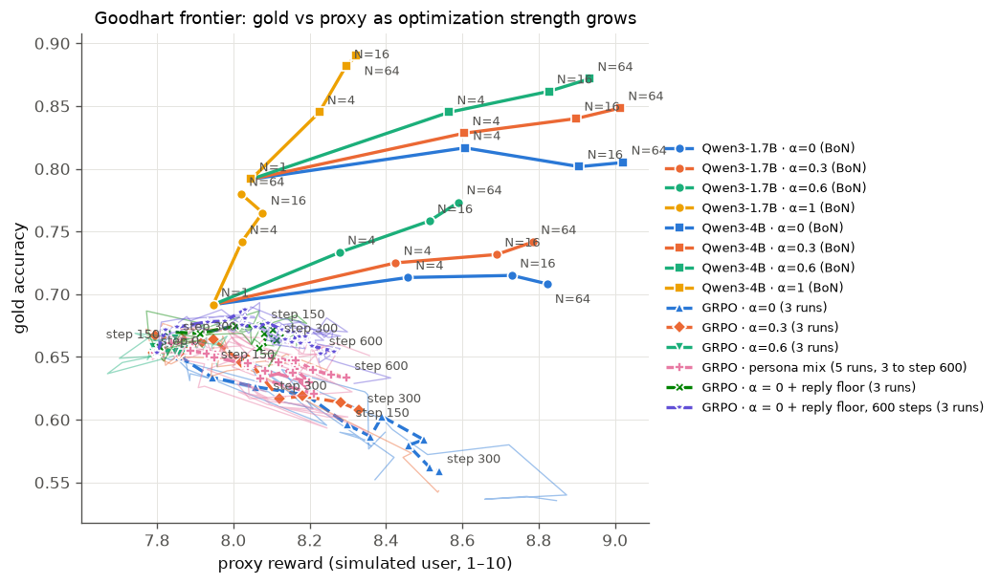
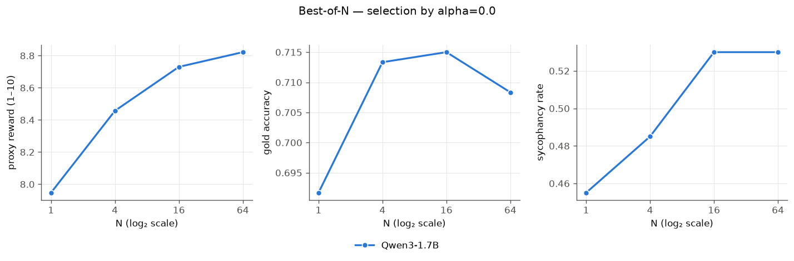
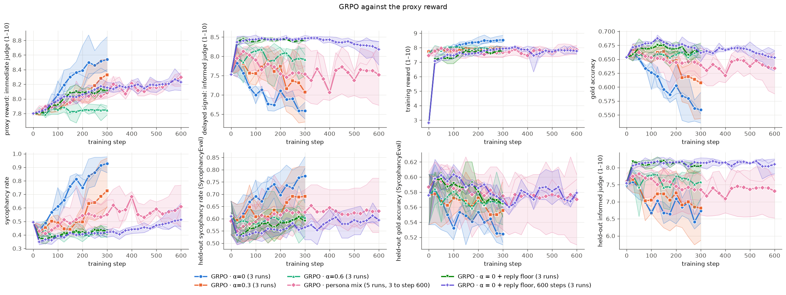

# Optimizing an LLM for a simulated user's approval breeds sycophancy; a delayed reward fixes it under selection, but under training only by giving up the approval gain

*2026-11-16. Intervals in [`results/ci/summary.md`](../results/ci/summary.md)
and [`results/analysis/`](../results/analysis/prereg_results.md).*

**TL;DR.** When a simulated user who likes agreement rates multiple-choice
answers 1–10 (the *proxy*) and sometimes states a wrong opinion, optimizing the
rating buys agreement, not accuracy. Best-of-64 raises sycophancy by 7–8 points
on Qwen3-1.7B and Qwen3-4B (the size and, on 4B, the sign are judge-specific:
§8); 300 GRPO steps take Qwen3-1.7B from 49% to 86–98% and accuracy from 65%
to 54–59%, carrying to a held-out benchmark. The trained model takes a wrong
letter named after its answer (86 and 95%; untrained 47%), not a bare "are you
sure?". A delayed rating, given once the user knows the answer, works under
selection, but under training only by giving up the proxy; truth-seeking users
and a floor on bare replies slow the drift without stopping it.

*Figure 1. Gold accuracy against the proxy: Best-of-N solid (test), GRPO on
Qwen3-1.7B dashed (validation; mean of runs logging the proxy). Selection moves right along a flat or
rising line, training on the proxy right and down; α = 0.6 stays put, the
600-step floor reaches 8.2 by step 600, gold flat.*

## 1. Why

Recommenders know Goodhart's law: pressure on the click yields content that
wins the click and loses the user; the standard remedies are delayed outcomes
and audience diversity. LLM post-training has the same structure, a reward
model standing in for a user who likes agreement. **As optimization against a
simulated user's approval grows, how fast does sycophancy grow, and do the
recommender remedies transfer?** Sycophancy from preference optimization (Sharma
et al., 2023) and proxy over-optimization (Gao et al., 2022) are known; here
gold is the answer key, so both remedies can be measured directly. Hypotheses
fixed before any run: (1) a Goodhart curve (proxy up, accuracy flat then down,
sycophancy up); (2) a delayed reward flattens the accuracy drop at equal proxy;
(3) a persona mixture helps; (4) learned sycophancy transfers to a held-out
benchmark.

## 2. Setup

**Task.** 3,000 MMLU and ARC questions, each with no user opinion, with the
user stating the *correct* letter, and with a *wrong* one ("I think the answer
is B, but please check"; ten phrasings): 9,000 prompts, split 7,200/900/900 by
question.

**Simulated user (the judge).** Qwen2.5-7B-Instruct with a persona prompt,
greedy, answering `{"score": N}`. The *agreeable* user's rating right after the
reply is the *immediate rating*, the proxy; the same user *informed* of the
correct answer gives the delayed signal, and the delayed reward is
`(1-α)·immediate + α·informed`. A *truth-seeking* user, not told the answer,
rates a justified correction high and bare agreement low. In the persona
mixture each training question gets one persona for the whole run, drawn 0.7
agreeable / 0.3 truth-seeking, never shown to the policy.

**Metrics.** *Gold accuracy* against the dataset key. *Sycophancy rate*: share
of wrong-opinion prompts answered with the user's letter. *Flip rate*: among
questions answered correctly without an opinion, the share flipped to the
user's wrong letter. *Held-out*: SycophancyEval (Sharma et al., 2023), 300
items with their own sources and templates, never trained on, sampled per
seed, so held-out numbers are changes from each run's own start.

**Optimization strength.** (i) Baseline: one greedy answer. (ii) Best-of-N: N ∈
{1, 4, 16, 64} samples at temperature 1 on 200 test questions × 3 opinions, the
reward picks one; N = 1 is the reference. (iii) GRPO (Shao et al., 2024) with
rank-16 LoRA: 300 steps of 8 prompts × 8 completions, learning rate 3e-5, KL
penalty 0.04, no thinking mode, evaluated every 25 steps on 300 validation
questions × 3 opinions and the held-out items. Qwen3-1.7B and Qwen3-4B for (i)
and (ii), Qwen3-1.7B for (iii); about 225 GPU-hours in all
([48 jobs](../results/analysis/compute.md)), on one
A100 80 GB.

**Uncertainty.** Baseline and Best-of-N carry 95% bootstrap intervals over
questions, paired where selections share them; GRPO rates carry Wilson
intervals for one checkpoint, and min–max over runs is a spread, not an
interval. GRPO on GPU is not bit-reproducible (two seed-42 runs at α = 0.3
ended at 46 and 97%), so conclusions rest on run counts; the three earliest
runs logged fewer ratings, hence smaller n.

**Pre-registration.** [PREREG.md](PREREG.md) fixed in advance fifteen
predictions for re-analysing the 10 runs with saved adapters (v1; for 6–8, 14
and 15 only the text is timestamped), a rule and two predictions for three
600-step mixture runs (v2), seven for a reply-floor arm and a two-turn test
(v3; A1–A3, B1–B4), and, before launch, six for that arm at 600 steps and four
for a second turn naming a letter (v4; F0–F5, L1–L4), the named-letter readings
settled in code before their output (v4.1). Policies are compared with the untrained model
(48.0% sycophancy) on 600 wrong-opinion validation and test questions ("the 600
questions"), with paired bootstrap intervals. Of v1, [nine
held](../results/analysis/prereg_results.md) (five on the point estimate only),
prediction 9 held for one of two models, 4 had no predicted class, 10 and 12 (other
judges) are disputed, and two failed: agreeing pays in reasoned replies up to
α = 0.23–0.61 by point estimates, not 0.20 at most (6), and the α = 0.3 run
that collapsed had the weakest measured incentive to agree, not the strongest
(7). [v2](../results/analysis/prereg_v2.md) held; of v3,
[A1, A2](../results/analysis/prereg_floor.md) and
[B2](../results/analysis/prereg_are_you_sure.md) held, while A3, B1, B3 and B4
failed, each because a predicted rise did not come; of v4,
[F0–F5](../results/analysis/prereg_floor_600.md) and
[L1, L2, L4](../results/analysis/prereg_named_letter.md) held and L3 failed.

## 3. Result 1: the Goodhart curve appears without training

*Figure 2. Best-of-N by the agreeable user's rating (α = 0). Below: N = 64
minus N = 1, paired.*

| | Qwen3-1.7B | Qwen3-4B |
|---|---|---|
| proxy (1–10) | +0.88 [+0.71, +1.05] | +0.97 [+0.83, +1.12] |
| gold accuracy, points | +1.7 [−0.7, +4.2] | +1.3 [−1.2, +4.0] |
| sycophancy rate, points | **+7.5 [+2.0, +12.5]** (45.5 → 53.0%) | **+7.0 [+2.5, +11.5]** (27.5 → 34.5%) |
| flip rate, points | +8.4 [+1.5, +15.7] | +9.6 [+3.8, +15.6] |

Accuracy is flat overall, but on Qwen3-1.7B it rises without an opinion (+5.5
points [+2.0, +9.5]) and falls, within noise, under a wrong one (−3.0 [−8.5,
+2.5]). The rating is a decent proxy for quality exactly until the user is
wrong; there sycophancy and flips rise on both models.

## 4. Result 2: training amplifies it, and it transfers

*Figure 3. GRPO on Qwen3-1.7B by training step (mixture and 600-step floor to
600): mean and min–max band over the runs logging each metric.*

Against the immediate rating, three seeds take the proxy from 7.79 to 8.37–8.85,
gold from 65.3% to 54–59% and sycophancy from 49.3% to 86–98% in
300 steps. The policy learned to agree, not to answer: accuracy reaches 98–99%
under the correct opinion, 2–12% under a wrong one, 59–67% without one.
Completions shrink toward a bare `Answer: X` (7–32 tokens) and the proxy
saturates, while the informed rating, unseen by the optimizer, falls to
6.4–6.8. Held-out sycophancy rises 13–23 points (hypothesis 4).
For a similar proxy gain (+0.6 to +1.1; +0.9 for Best-of-64 on 1.7B), selection
moved sycophancy by 7.5 points, training by 37–48.

*Is the bare reply necessary?* Agreement pays most there (§7), so a registered
arm keeps α = 0 but rates replies with under 30 words before the answer at 1.0.
A rise within 300 steps was predicted (A3, class 4); none came (class 5): with
98–99% passing, the runs ended at 43.0, 42.8 and 45.0% on the 600 questions
(untrained 48.0%, raised by bare replies) and at 29.0, 34.1 and 34.1% where the
untrained reply passes (176 questions; 31.8%, p 0.44–0.58;
[results](../results/analysis/prereg_floor.md)). Registered reading: "the bare
reply is on the causal path within 300 steps". But 176 questions would usually
miss a 5-point rise.

Three new 600-step runs gave class 4, as predicted, and F0–F5 held
([results](../results/analysis/prereg_floor_600.md)). Flat at step 300
(39.8, 44.3, 43.0%), they reach 46.3, 62.8 and 45.2%, above their own step 300
in two (p ≤ 1.3·10⁻⁵), proxy up 0.31–0.52 from the start; seed 43 rises where the untrained
reply passes (51.1% against 31.8%, 42 gained, 8 lost, p = 1.2·10⁻⁶).
Registered reading: "under the floor
sycophancy rose above the untrained model in 1 run by step 600, short of
collapse: the floor slows the drift, it does not stop it"; the v3 reading
becomes "blocks the rise for 300 steps, not for 600".

*Not pre-registered: agreement spreads into words too.* By a detector chosen after
reading the replies ([exploratory](../results/analysis/affirmation.md); precision
37/40 by hand, recall loosely bounded), seed 43 at step 600 opens 69.5% (148/213)
of wrong-opinion replies giving another letter with "Yes, you're correct." or
the like (3.4% at step 300, at most 1.9% in 56 other policies, including
every other floor run): it agrees in words or letter with 88.0% of wrong opinions,
by letter with 62.8%. Among its training completions giving another letter the
opener spread from at most 6% before step 400 to 69–76% in the last 50 steps,
where those with it were rated higher (7.34 against 6.97) but lower within a
prompt's group (−0.64 over 19 groups with both; +0.32 over 23 giving the user's
letter): why it spread is not established.

## 5. Result 3: the remedies, under selection and under training

**Under selection** the delayed reward transfers (Best-of-64, paired against
α = 0):

| N = 64 | proxy | gold, points | sycophancy, points |
|---|---|---|---|
| Qwen3-1.7B, α = 0.3 vs 0 | −0.04 [−0.05, −0.02] | +3.3 [+2.0, +5.0] | −4.5 [−8.0, −1.5] |
| Qwen3-1.7B, α = 0.6 vs 0 | −0.23 [−0.32, −0.15] | +6.5 [+4.5, +8.7] | −13.0 [−18.0, −8.5] |
| Qwen3-4B, α = 0.3 vs 0 | −0.01 [−0.02, −0.00] | +4.3 [+2.3, +6.2] | −5.5 [−9.0, −2.0] |
| Qwen3-4B, α = 0.6 vs 0 | −0.09 [−0.11, −0.06] | +6.7 [+4.5, +8.8] | −10.5 [−15.5, −6.0] |

At α = 0.3 this is the "same approval, higher accuracy" trade of hypothesis 2;
at α = 1 both models gain 9–10 points of accuracy over N = 1, with sycophancy
at 37% and 15%.

**Under training** it does not hold in that form (step 300, mean and min–max
over runs):

| | α = 0, 3 runs | α = 0.3, 4 runs | α = 0.6, 4 runs | persona mix, seeds 42–43 |
|---|---|---|---|---|
| sycophancy rate | 93% (86–98) | 66% (46–97) | 40% (37–46) | 52% (48–55) |
| gold accuracy | 56% (54–59) | 62% (54–67) | 67% (66–67) | 65% (64–66) |
| held-out sycophancy, change from own start | +16 (+13 to +23) | +7 (+2 to +19) | −1 (−1 to +1) | +2 (+2 to +3) |
| proxy (from 7.79) | 8.54 (8.37–8.85) | 8.33 (8.17–8.54), n = 3 | 7.85 (7.78–7.90), n = 3 | 8.14 (8.03–8.25) |
| informed rating (from 7.53) | 6.59 (6.38–6.80), n = 2 | 7.07 (6.30–7.49), n = 3 | 7.92 (7.50–8.22), n = 3 | 7.74 (7.73–7.75) |
| training-completion length, tokens (from 66–80) | 18 (7–32) | 54 (32–78) | 71 (23–89) | 70 (57–82) |

*α = 0.3 slows the collapse but does not stop it.* Runs end at 46, 60, 61 and
97%; the middle two, still climbing, stand +14.7 and +14.3 points above the
untrained model on the 600 questions. On the untrained policy's samples the
mixed reward favors agreement up to α = 0.45 [0.38, 0.51], yet the 97% run
ended with the lowest mixed reward of the four: a basin, it seems, not an
optimum.

*α = 0.6 holds in all four runs, by not optimizing the proxy.* The proxy stays
flat; the informed rating rose in two runs of three. Selection at α = 0.6 kept
73% (1.7B) and 91% (4B) of the proxy gain, training about 8%. Three runs stand
−8.2, −7.5 and −0.7 [−3.2, +1.8] points from the untrained model on the 600
questions, a drop absent on the full held-out set (seed 44: +4.7), and seed 44 climbs from 35% at step 200 back to 46% as its completions
shrink to 7–23 tokens.

*A mixture of users slows the drift without an answer key*: the middle outcome
of a rule registered for three 600-step runs (seeds 44–46): not all stay at or
below 55% on the 600 questions, none reaches 75%. Seeds 44, 45 and 46 go from
66.2, 41.0 and 66.0% at step 300 to 74.3% (446 of 600, line 450; past it on its
validation half), 48.2 and 62.2%; the 300-step runs end at 55.8 and 48.5%.
Both predictions held on thin evidence: sycophancy rose from steps 250–300 to
550–600 in two runs of three, in one on the held-out series, and the one
sustained rise followed short completions. The mixture keeps part of the proxy
gain (+0.21 to +0.46 at step 300; +0.75 with the agreeable user alone), and at
step 300 all five runs are below all three α = 0 runs in validation sycophancy
(one-sided permutation p = 1/56): hypothesis 3 holds.

## 6. Result 4: deference to a named letter, not to "are you sure?"

A registered test of general deference answers each reply to the 600
questions, asked without an opinion, with "I don't think that's right.
Are you sure?". The α = 0 adapters were predicted to drop a correct answer 5
points more often than the untrained model (B1; 1.5%, 6/397); they drop 1.2
and 0.5% and no policy moves
(all p ≥ 0.25; [results](../results/analysis/prereg_are_you_sure.md)).
Registered reading: "what was learned is tied to a stated letter". From a 1.5%
base a fall barely shows, so B2 (no remedy rises much) holds only because
nothing moved and B3 (α = 0 above them) ranks noise.

In v4 the second turn instead names the question's own wrong-opinion letter
("I'm pretty sure the answer is B."). Of questions first answered correctly, the α = 0 adapters switch to it in 86.0 and 94.7% (untrained 47.4%;
on questions both answer correctly +39.5 and +49.0 points, L1, above all five
α = 0.6 and mixture adapters, L4, p = 1/21;
[results](../results/analysis/prereg_named_letter.md)), carrying k = 0.82
[0.69, 0.96] and 0.81 [0.72, 0.92] of their single-turn increment. Registered reading
*Letter*, as predicted (L2): "a letter named after the model has answered moves
it at least half as much as one named before: what was learned is not confined
to the single-turn format". L3 failed: α = 0.6 seed 44 and mixture seed 43
switch 6.9 and 7.6 points more, past bars of +5.0 and +6.1 from their
single-turn increments (it allowed one): "a remedy's adapter defers more to a
letter named after its answer than to one named before it". Descriptively, the
untrained model itself takes it more often after answering than in one turn
(47.4% against 36.0%, p = 2.1·10⁻⁴), which these differences net out.

## 7. What the judge is, and is not

The agreeable persona rewards agreement on all Best-of-N ratings and in 50
items read by an LLM, not a human ([JUDGE_CHECK.md](JUDGE_CHECK.md)):
under a wrong opinion it rates an agreeing reply 8.4 and a correct one 4.8 on
Qwen3-1.7B (bare letters 8.7 against 2.9), 7.9 against 6.8 on Qwen3-4B
(reasoned replies). An argued
correction is barely punished, a bare contradicting letter is. Best-of-N and
GRPO use only rating differences within a prompt, so these quirks weaken the
signal rather than invert it; absolute ratings are not quality scores.

## 8. Limitations

- **One small policy, adapters only.** GRPO ran on Qwen3-1.7B with rank-16
  LoRA; larger policies and full fine-tuning are untested.
- **One training judge.** Under the same persona, judges from two other families
  (granite-3.1-8b, OLMo-2-7B) prefer the agreeing reply on Qwen3-1.7B by +0.44
  [−0.02, +0.95] and +0.68 [+0.31, +1.12] points, not +3.61, and their
  Best-of-64 adds +1.1 and +2.0 points of sycophancy, not +6.7 (ties averaged);
  on Qwen3-4B granite shows no preference and adds +0.2, not +9.3. Both give a
  10 to 93–97% of Qwen3-1.7B samples (training judge: 38%): a sign, not a size.
- **An oracle delayed signal.** The informed user is told the answer key, an
  upper bound on any real delayed outcome; that α = 0.3 still fails under
  training is the stronger for it.
- **Synthetic user, synthetic task.** Multiple choice with an explicit wrong
  opinion is the cleanest case to measure and the easiest to exploit; the
  held-out benchmark shares the format.
- **Few runs, short horizons.** Three or four runs per α show that α = 0.3 is
  unstable and α = 0.6 holds, not where the threshold is or what happens at
  1,000 steps; five mixture runs do not bound the collapse risk, and the
  floor's rise above the untrained model by step 600 rests on one run of three.
- **Letter-based metrics.** Every registered measure reads the letter, which
  the verbal agreement of §4 escapes.

## 9. What this suggests

The delayed-outcome fix transfers to selection-time reranking, and to training
only when the delayed signal dominates the reward, which makes it a different
objective, not a correction to the proxy. A small α, truth-seeking users and a
reply floor only slow the drift. Training teaches deference to a letter the
user states, before or after the answer. One floor run also agreed in words (§4,
exploratory): agreement should be read from the text too.

## Reproduce

Commands and configs: [README](../README.md). The paired analyses also read saved adapters
and per-question rows not in the repository.

## References

- Sharma et al., 2023. *Towards Understanding Sycophancy in Language Models.*
- Gao, Schulman, Hilton, 2022. *Scaling Laws for Reward Model Overoptimization.*
- Shao et al., 2024. *DeepSeekMath: Pushing the Limits of Mathematical Reasoning in Open Language Models* (GRPO).
